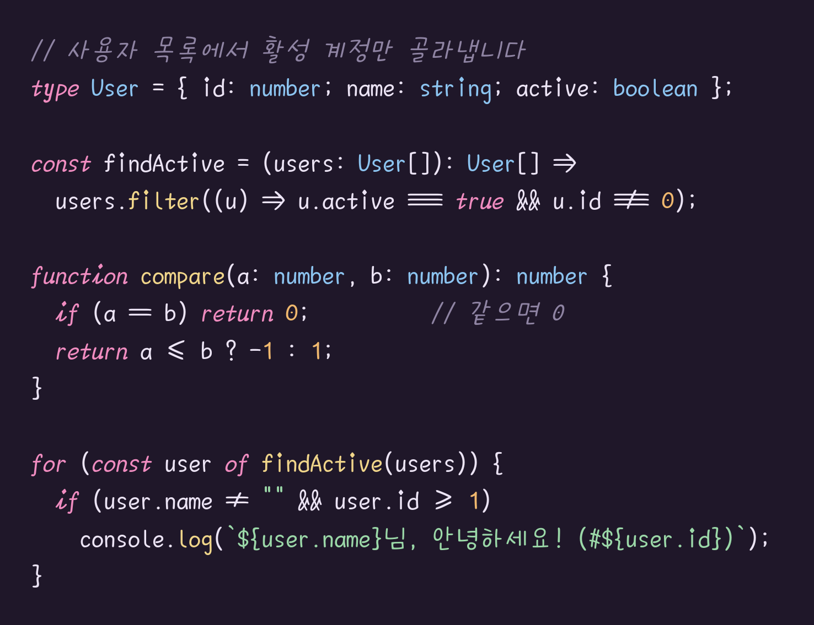
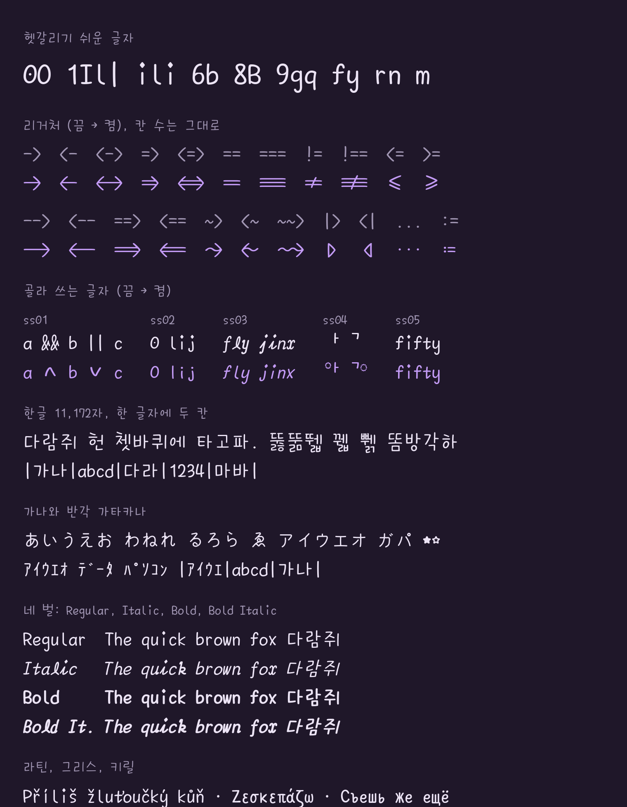
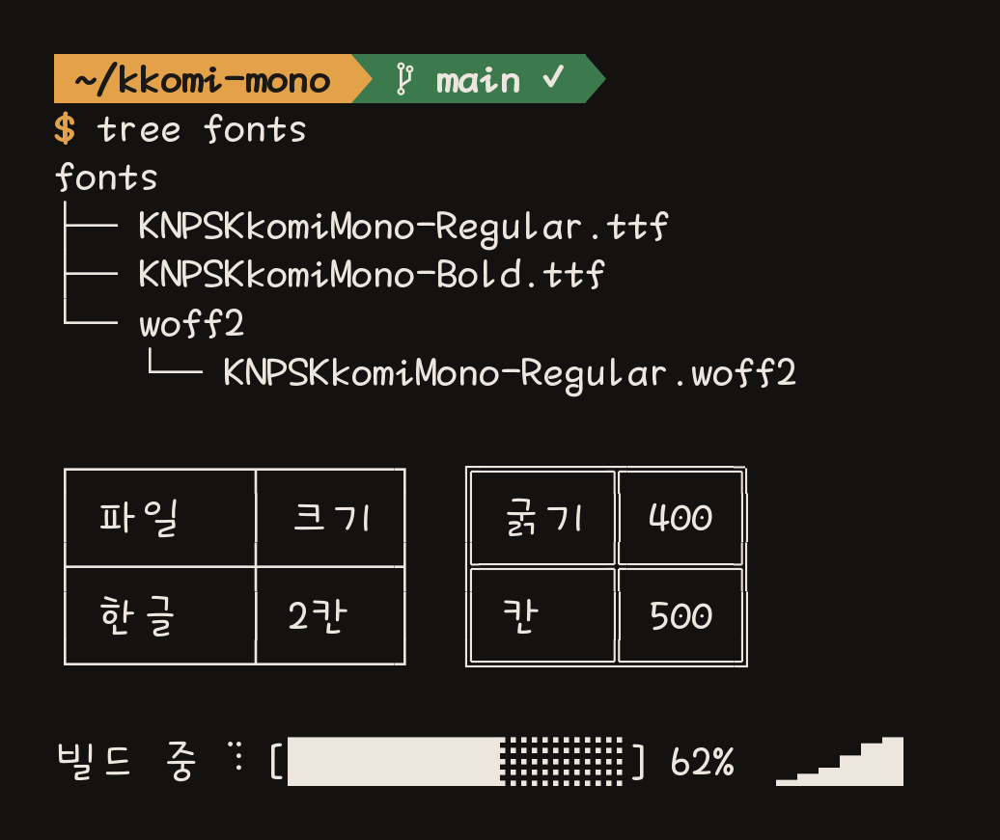

# KNPS Kkomi Mono

국립공원공단의 **국립공원 꼬미체**(KNPS Kkomi)를 에디터와 터미널에서 쓰도록 고정폭으로 바꾼 폰트입니다.

- 라틴 문자와 기호는 한 칸(500), 한글은 두 칸(1000)입니다 (UPM 1000).
- Regular, Italic, Bold, Bold Italic 네 벌이 있습니다.
- [웹에서 미리보기](https://dj-lumiere.github.io/kkomi-mono/) · [글자 목록](https://dj-lumiere.github.io/kkomi-mono/chars.html) · [내려받기](https://github.com/dj-lumiere/kkomi-mono/releases/latest)







## 설치

`fonts/` 폴더의 네 파일을 함께 설치합니다.

| 파일 | 굵기 |
|---|---|
| `KNPSKkomiMono-Regular.ttf` | 400 |
| `KNPSKkomiMono-Italic.ttf` | 400, 라틴만 13° 기울임 |
| `KNPSKkomiMono-Bold.ttf` | 700 |
| `KNPSKkomiMono-BoldItalic.ttf` | 700, 라틴만 13° 기울임 |

VS Code 예:

```json
"editor.fontFamily": "'KNPS Kkomi Mono'",
"editor.fontLigatures": true,
"terminal.integrated.fontFamily": "'KNPS Kkomi Mono'"
```

### 웹에서 쓰기

`fonts/woff2/`에 같은 네 벌의 woff2 파일이 있습니다. 하나에 약 1.7MB입니다.

```css
@font-face { font-family: "KNPS Kkomi Mono"; src: url("KNPSKkomiMono-Regular.woff2") format("woff2"); font-weight: 400; font-style: normal; }
@font-face { font-family: "KNPS Kkomi Mono"; src: url("KNPSKkomiMono-Italic.woff2") format("woff2"); font-weight: 400; font-style: italic; }
@font-face { font-family: "KNPS Kkomi Mono"; src: url("KNPSKkomiMono-Bold.woff2") format("woff2"); font-weight: 700; font-style: normal; }
@font-face { font-family: "KNPS Kkomi Mono"; src: url("KNPSKkomiMono-BoldItalic.woff2") format("woff2"); font-weight: 700; font-style: italic; }
code, pre { font-family: "KNPS Kkomi Mono", monospace; }
```

## 원본과 달라진 점

**고정폭**
- 넓은 라틴 문자는 가로로 줄이고 세로획 굵기를 보정했습니다.
- 한글은 두 칸을 채우도록 키우고 획 굵기를 다시 맞췄습니다. `고 두 드`처럼 좁은 글자는 가로로 최대 1.6배까지 늘립니다.
- 가나는 두 칸에 두되 92%로 줄이고 획 굵기는 그대로 두었습니다. 원래 크기로는 한글 옆에서 더 크고 진해 보입니다.
- `*`를 `+ - =`와 같은 높이로 내렸습니다.

**헷갈리기 쉬운 글자**
- `0`에 가운데 점을 넣었습니다.
- `i`에 깃을 달고, 아래를 `t`의 갈고리 모양으로 바꿨습니다.
- `l`은 둥근 붓 한 획으로 새로 그렸습니다. 곧게 내려와 아래에서 오른쪽 아래로 짧게 꺾여 내려가는 꼬리가 있습니다.
- `9`는 `6`을 반 바퀴 돌린 모양입니다. 꼬리가 안쪽으로 휘어 `q`와 구별됩니다.
- `\` 자리에 원화 기호 대신 역슬래시를 넣었습니다.

**한글**
- 원본에서 빈칸이던 8,362자를, 원본 글자의 자모(초성, 모음, 받침)를 떼어 내 조합해 만들었습니다. 이제 11,172자가 모두 있습니다.
- 자모로 분해된 한글(macOS 파일 이름 등)이 완성 음절로 보이도록 조합 규칙을 넣었습니다.
- 조합이 안 되는 곳(일부 터미널)에서는 조합용 자모를 정해진 자리에 그립니다. 초성은 위 왼쪽, 세로 모음은 오른쪽, 가로 모음은 초성 밑, 받침은 아래쪽이라 겹쳐도 한 음절로 읽힙니다.
- 초성 하나만 있거나, 다른 글자 뒤에 중성·종성이 오면 낱자 모양(`ㄱ`, `ㅏ`)으로 두 칸에 따로 나옵니다. 초성 바로 뒤의 종성(`ᄀᆲ`)은 두 칸 안에 겹쳐 그립니다.
- 낱자 모음(`ㅏ ㅜ ㅡ` 등)은 두 칸의 가운데, 한글 음절의 가운데 높이에 놓았습니다.
- 초성 채움(U+115F)과 중성 채움(U+1160)을 넣었습니다. 보이지 않는 글자입니다.
- `법`의 ㅂ 받침이 다른 ㅓ 글자보다 훨씬 넓어서, `업`의 받침으로 바꿨습니다.

**리거처** (`calt`)
- 화살표: `->` `<-` `<->` `=>` `<=>` `-->` `<--` `==>` `<==` `~>` `<~` `~~>`
- 비교: `==` `===` `!=` `!==` `<=` `>=`
- 그 밖: `>>=` `=<<` `<>` `|>` `<|` `/\` `\/`
- 리거처도 원래 글자 수만큼의 칸을 차지해서, 열이 어긋나지 않습니다.
- `<!--` `====` `<==>` `<|>`처럼 앞뒤에 연산자 글자가 붙으면 리거처가 생기지 않습니다.
- `/\` `\/`는 앞뒤가 영문자, 숫자, `_`가 아닐 때만 바뀝니다. 정규식 `/\d+/`나 `http:\/\/`는 그대로 나옵니다.

**추가한 글자**
- 라틴 확장-A, 악센트 글자, 강세 부호가 붙은 그리스 문자
- 낱자 자음 `ㄱ ㄾ` 등은 원본의 비율과 자리를 지킵니다. 낱자 모음 `ㅏ ㅜ ㅡ` 등은 두 칸의 가운데에 놓습니다.
- 수학 연산자를 원본 글자와 리거처 부품으로 다시 그렸습니다. `∪ ∩ ⊂ ⊃ ⊆ ⊇ ∈ ∋`는 `U`, `≤ ≥ ≪ ≫ ≠ ≡`는 `< > = /`, `∃ ⊥`는 `E T`를 뒤집은 것, `∏`는 `ㅠ`, `∑`는 `M`을 돌린 것, `∂`는 `6`을 뒤집고 위를 둥글게 말아 올린 것입니다. `≤ ≥ ⊆ ⊇`의 아래 줄은 `_`입니다. `∀ ∇ ∆ √`는 원본의 둥근 붓 끝으로 새로 그렸습니다.
- `㎏ ㎞ ㎒` 같은 단위 기호를 원본의 라틴 글자를 이어 붙여 두 칸에 넣었습니다. 세 글자가 넘으면 가로로 좁힙니다. `㎧ ㎨ ㎮ ㎯ ㏆`처럼 `/`가 있는 단위는 분수처럼 위아래로 쌓았습니다.
- `Ą ę Ų` 같은 ogonek 글자는 갈고리를 둥근 붓 한 획으로 그려 글자 바닥에 붙였습니다. `ſ`는 `f`에서 가로획을 빼고 줄기를 매끄럽게 이었습니다.
- 낱자 `ㄱ ㅏ ㄾ` 등은 원본의 비율과 자리를 지킵니다. `ㅏ`의 세로획은 가운데 가까이 옵니다.
- `⑯~⑳` `⒃~⒇`의 숫자는 `⑮` `⒂`의 숫자와 같은 크기입니다.
- 분수 `¼ ½ ¾ ⅓ ⅛` 등은 분자, 가로줄, 분모를 위아래로 쌓아 한 칸에 넣었습니다.
- `· ¢ £ ¥ ¬ ‾`는 원본에서 전각 글자와 모양을 함께 써서 두 칸이었습니다. 한 칸짜리를 따로 만들었습니다.
- 위·아래 첨자, `⑯~⑳` `⒃~⒇` `㈝ ㈞`, 제어 문자 그림 기호(`␀ ␛ ␡` 등)
- 터미널 기호: 박스 선, 블록, 점자, Powerline. 칸에 맞춰 그려서 위아래·좌우가 이어집니다.
- 일본어 장음 기호 `ー`와 탁점·반탁점 `゛` `゜`. 원본 `ニ` `ガ` `パ`의 획을 가져왔습니다.

**한자는 없습니다.** 원본에도 없어서 시스템 폰트로 나옵니다. 한자 폰트는 거의 모두 한 글자가 1em이라 두 칸과 폭이 같고, 글꼴 모양만 다릅니다.

**Italic**
- 라틴 문자만 기울이고, 한글은 똑바로 둡니다.
- `a d h m n u`에 갈고리를 달고, `f`는 기준선 아래로 내렸습니다.
- `x`는 `c`와 그 좌우 대칭을 등을 맞대어 붙인 `ɔc` 모양으로 바꿨습니다.
- `l`은 `ℓ`처럼 아래에서 한 번 꼬인 고리 모양입니다. 꼬리가 칸의 왼쪽 아래와 오른쪽 아래로 뻗습니다.

**굵기**
- Regular는 세로획이 대문자 높이의 약 12.5%, Bold는 약 17%가 되도록 획을 고르게 두껍게 했습니다.

## 다시 만들기

Python 3과 `fonttools`, `skia-pathops`가 필요합니다.

```sh
pip install fonttools skia-pathops brotli
cd tools
python make_mono_static.py ../source/KNPSKkomi.otf ../base/KNPSKkomiMono-Base.ttf "KNPS Kkomi" "KNPS Kkomi Mono"
python make_italic.py ../base/KNPSKkomiMono-Base.ttf ../base/KNPSKkomiMono-BaseItalic.ttf
python make_bold.py ../base/KNPSKkomiMono-Base.ttf ../fonts/KNPSKkomiMono-Regular.ttf Regular
python make_bold.py ../base/KNPSKkomiMono-BaseItalic.ttf ../fonts/KNPSKkomiMono-Italic.ttf Italic
python make_bold.py ../base/KNPSKkomiMono-Base.ttf ../fonts/KNPSKkomiMono-Bold.ttf Bold
python make_bold.py ../base/KNPSKkomiMono-BaseItalic.ttf ../fonts/KNPSKkomiMono-BoldItalic.ttf "Bold Italic"
```

woff2는 TTF를 다 만든 뒤 fontTools로 바꿉니다(`TTFont(path).flavor = "woff2"` 후 저장).

첫 단계는 한글 조합 규칙 때문에 2분쯤 걸립니다. `samples/`의 두 파일로 한글, 기호, 리거처, 터미널 기호가 제대로 나오는지 확인할 수 있습니다.

## 라이선스와 출처

- **폰트** (`fonts/`, `base/`, `source/`): 본 저작물은 국립공원공단에서 2021년 작성하여 공공누리 제1유형으로 개방한 국립공원공단 꼬미(작성자: 국립공원공단)를 이용하였으며, 해당 저작물은 국립공원공단, <http://www.knps.or.kr> 에서 무료로 다운받으실 수 있습니다. ([공공누리 안내](https://www.kogl.or.kr/recommend/recommendDivView.do?recommendIdx=41248&division=font))
  이 폰트를 쓰거나 다시 배포할 때도 이 출처를 함께 밝혀야 합니다. 바꾼 내용은 `출처.txt`에 정리되어 있습니다.
- **빌드 스크립트** (`tools/`): MIT 라이선스입니다(`tools/LICENSE`).
